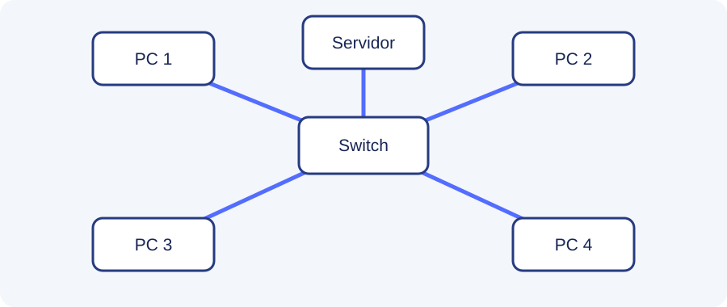

# Fundamentos de redes

## Que es una red informatica

Una red informatica es un conjunto de dispositivos conectados entre si para intercambiar datos y compartir recursos, como archivos, impresoras o una conexion a Internet.

## Tipos de redes

- **LAN:** red de area local, por ejemplo la de una casa o un instituto.
- **MAN:** conecta redes dentro de una ciudad o zona metropolitana.
- **WAN:** cubre grandes distancias. Internet es el ejemplo mas conocido.

## Topologias

La topologia describe como se conectan los dispositivos.

En una topologia en estrella, todos los equipos se conectan a un dispositivo central, normalmente un switch.

## Dispositivos principales

| Dispositivo | Funcion |
|---|---|
| Router | Conecta redes diferentes y dirige paquetes |
| Switch | Conecta dispositivos dentro de una LAN |
| Punto de acceso | Permite conectar equipos por Wi-Fi |
| Tarjeta de red | Proporciona la conexion de red a un equipo |

!!! warning "No son lo mismo"
    Un switch conecta equipos dentro de una red local. Un router permite comunicar redes diferentes, por ejemplo una LAN con Internet.

## Ventajas de una red

1. Compartir archivos y dispositivos.
2. Facilitar la comunicacion.
3. Centralizar servicios y copias de seguridad.
4. Compartir el acceso a Internet.
