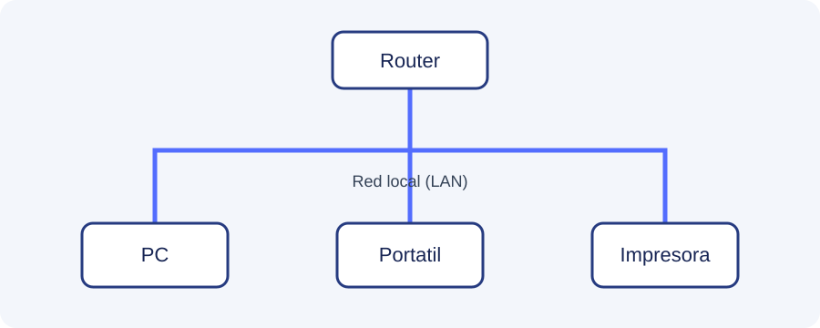

# Redes informaticas

Bienvenido a esta guia introductoria sobre las **redes informaticas**. Una red permite conectar varios dispositivos para intercambiar informacion y compartir recursos.

## Que aprenderas

- Que es una red y cuales son sus componentes.
- Como se organiza el direccionamiento IP.
- Como comprobar si existe comunicacion entre dispositivos.

!!! info "Objetivo de la guia"
    Entender los conceptos basicos necesarios para configurar y diagnosticar una red local.

## Contenido

| Apartado | Descripcion |
|---|---|
| [Fundamentos de redes](fundamentos.md) | Tipos, topologias y dispositivos |
| [Direccionamiento IP](direccionamiento.md) | IPv4, mascara y puerta de enlace |
| [Diagnostico de red](diagnostico.md) | Comandos para comprobar conexiones |

## Ejemplo de comunicacion

Cuando un ordenador envia datos a otro dispositivo, la informacion se divide en paquetes. Estos paquetes viajan por la red hasta llegar a su destino.

[Documentacion oficial de Cisco sobre redes](https://www.cisco.com/).

!!! tip "Idea clave"
    Internet es una red de redes. Una red local (LAN) puede funcionar aunque no tenga conexion a Internet.
